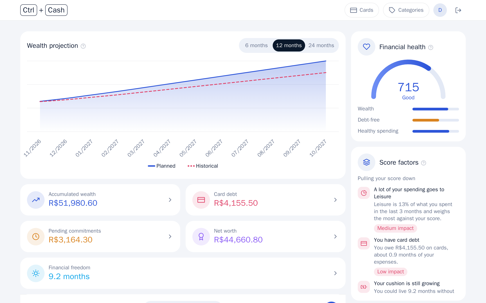
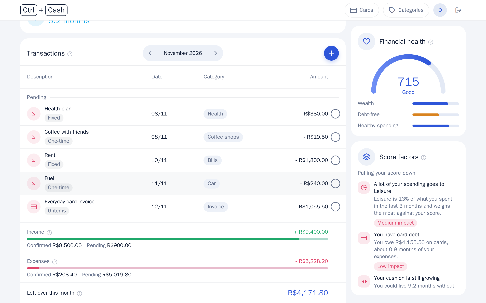
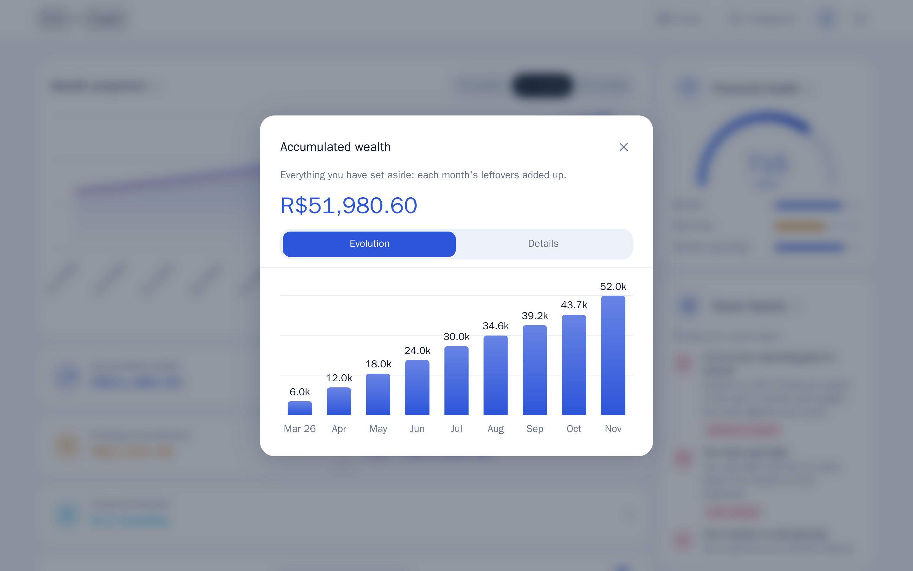
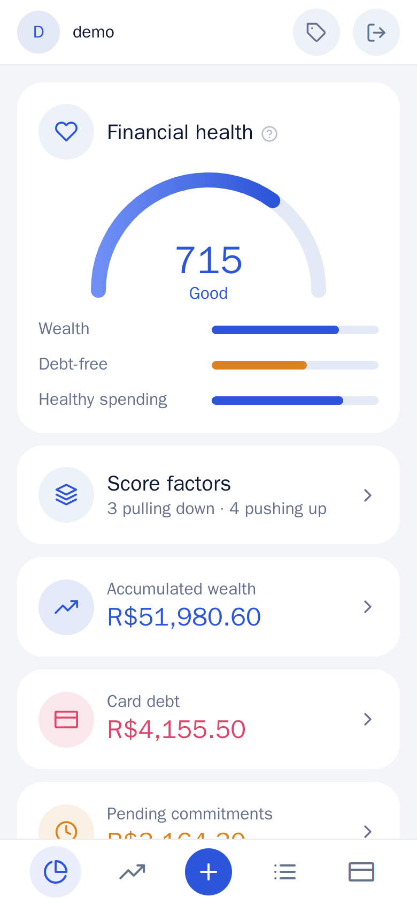
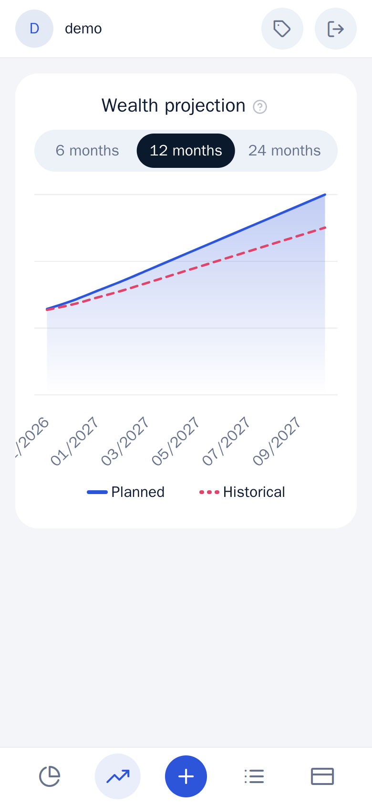
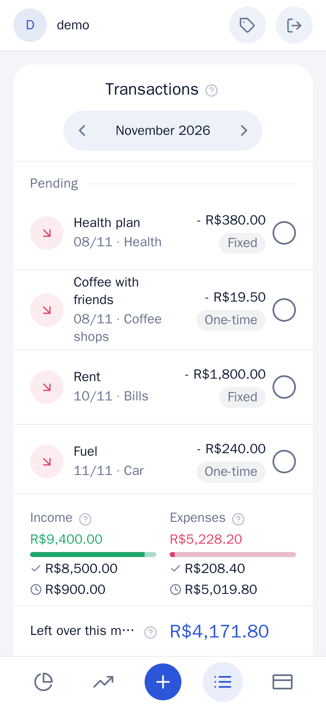
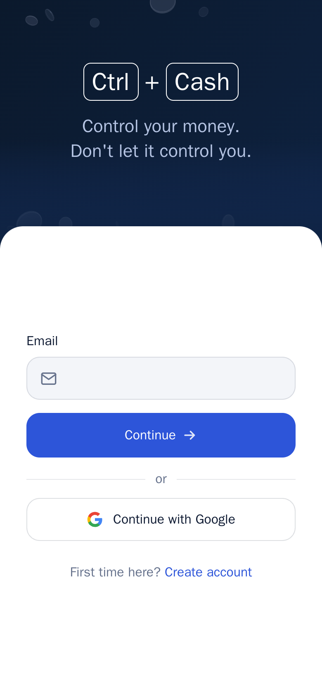
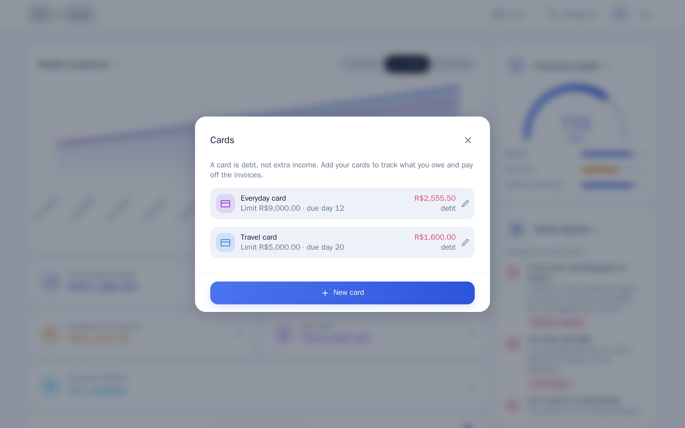
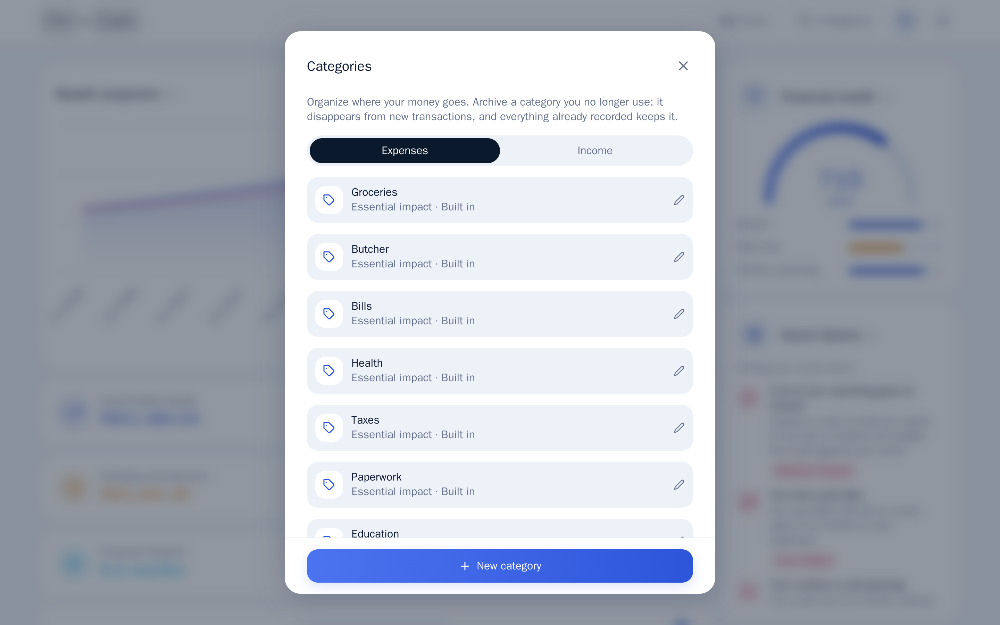
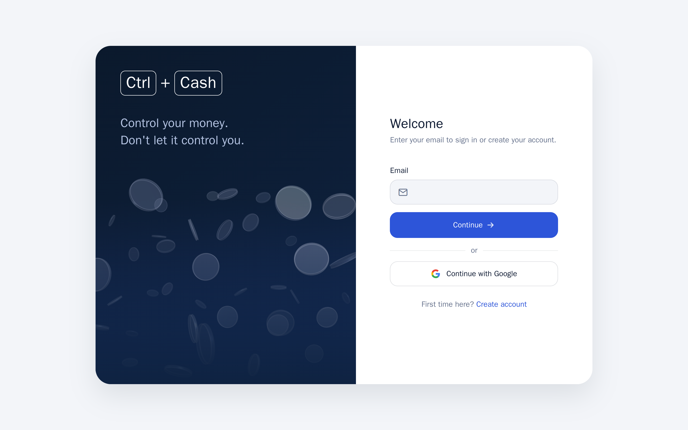

<h1 align="center">Ctrl+Cash</h1>

<p align="center">
  <b>Control your money. Don't let it control you.</b><br>
  A personal finance app built around one idea: everything that is left over in a month is wealth, and a credit card is the debt it really is. It projects where your net worth is heading, scores your financial health from 0 to 1000 and tells you, in plain words, what is pulling that score down or up.
</p>

<p align="center">
  <a href="https://github.com/gustavocoimbradev/ctrl-cash/actions/workflows/ci.yml"></a>
  
  
  
  
  <a href="LICENSE"></a>
</p>

<p align="center"></p>

<p align="center"><b>Live: <a href="https://ctrlcash.gustavocoimbra.com">ctrlcash.gustavocoimbra.com</a></b></p>

## What it does

You register what comes in and what goes out (fixed bills, installments, card purchases, one-off spending) and Ctrl+Cash does the rest:

1. **Projects your wealth** for 6, 12 or 24 months: a planned line from what is already registered, and a historical line that also subtracts your typical one-off spending of the last 3 months.
2. **Treats cards as debt:** invoices, installments, payments and what you really owe, subtracted from your net worth.
3. **Scores your financial health** (0 to 1000) from three parts, wealth (your cushion in months of expenses), debt and spending quality, and explains the score in plain language: what pulls it down and what pushes it up, each with its impact.

<table>
  <tr>
    <td width="50%"></td>
    <td width="50%"></td>
  </tr>
</table>

## Run it

Needs Docker and Node 20 or newer.

```bash
make up:dev   # development: database, API, a local sign-in emulator and the app, with a demo account
make up:prod  # production: asks for your address the first time, then builds and runs it for good
```

In development the demo account is `demo@ctrlcash.dev` / `demo1234` (it only exists on your machine). `make down:dev` stops it, `make test:dev` runs the checks, `make screenshots` retakes the pictures below. Every command comes in a `:dev` and a `:prod` version (`make logs:prod`, `make status:prod`, `make backup:prod`...); see the top of the [Makefile](Makefile).

## Put it on your own server

It runs on any machine with Docker, behind its own HTTPS (automatic) or behind a Cloudflare Tunnel.

1. Clone it on the server (the deploy workflow expects the folder `~/ctrl-cash`) and run `make env:prod`: it creates `.env.prod` and asks for the address.
2. Edit `.env.prod`. Behind a tunnel, create **a tunnel of its own** for this project, put its token in `TUNNEL_TOKEN` and point the tunnel's public hostname at `http://web:80`. Without a tunnel, the address must be a domain that points at the server, with ports 80 and 443 open.
3. `make up:prod`. The database password is generated for you.
4. Sign-in needs your Firebase project to allow the address: **Authentication, Settings, Authorized domains**, and restrict the web API key to your site in the Google Cloud console.
5. **Updates on every push** (`.github/workflows/deploy.yml`): install a self-hosted GitHub runner on the server, in its own folder. When the checks pass on `main`, the runner pulls the code and runs `make up:prod`. It never runs for pull requests, so it is safe on a public repository.

Moving from the old Firestore version? `npm run firebase:export` writes every account's data to a private JSON file and `make import:prod FILE=...` loads it into PostgreSQL (safe to run twice; `DRY=1` only checks).

## What is in it

- **Nothing is ever deleted:** removing a transaction, a payment, a card or a category archives it. The API has no delete at all, so past records are never damaged, and an archived card or category keeps its history.
- **Each account sees only its own data:** the API verifies the person's Firebase token on every request and scopes every query to it. Validation rules mirror the database constraints, and the tests cover isolation, atomic writes and every rule.
- **Email-first sign-in:** type your email, and the form shows the password field, the account creation (with a repeat-password field) or the Google button. Email, password and Google sign-in come from Firebase.
- **Made to be read:** sticky headers and summaries, a month summary that splits income and expenses into confirmed and pending, short "?" explanations on every card, and a score card that says in plain words what is going on.
- **Categories you control:** create, rename, set how much a category weighs on your score, and archive.
- **Phone and desktop:** a bottom bar on the phone, a sticky side column on the desktop, and an install banner (a real install prompt on Chrome and Edge, a step by step guide on iPhone).
- **A small 3D touch:** the sign-in screen has coins floating in depth (Three.js) that react to the pointer, and hold Ctrl to stack the ones near it.

<table>
  <tr>
    <td width="25%"></td>
    <td width="25%"></td>
    <td width="25%"></td>
    <td width="25%"></td>
  </tr>
</table>

<table>
  <tr>
    <td width="50%"></td>
    <td width="50%"></td>
  </tr>
</table>

<p align="center"></p>

## Under the hood

**Expo / React Native** (one TypeScript code base for web, iOS and Android; the web build is what runs in production), **Fastify** API (Node 22, TypeScript) with **PostgreSQL 16**, and **Firebase Authentication** only to sign people in. Amounts are integer cents. CI runs the type checks, the API tests against a real PostgreSQL and the web build.

```
src/        the app (screens, components, pure domain rules, state and sync)
backend/    the API: Fastify, PostgreSQL migrations, validation, tests, import tool
docker/     production image and proxy (Caddy)
scripts/    make up:dev, make up:prod, demo data, screenshots, Firebase admin tools
docs/       screenshots
```

## License

[MIT](LICENSE): free to use, copy, modify and distribute, including commercially, as long as the copyright notice (credit to **Gustavo Coimbra**) is kept.
